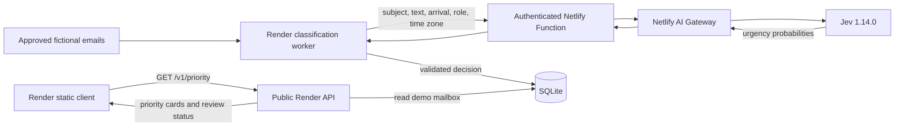

# Public demo architecture

The sample provider supplies a fixed set of fictional deliveries. The worker claims jobs for the public demo mailbox and uses the same Jev relay as the comparison CLI. The mailbox namespace includes a digest of the pinned model, rubric, recipient context and sample inputs so a changed corpus gets fresh reviews. Completed decisions survive a restart while the SQLite file exists.

The priority policy admits an email when Emergency plus Urgent probability is at least 0.80. An admitted email is Emergency at an Emergency probability of at least 0.75. Other admitted emails are Urgent. The public read path uses the model's stored tier and excludes records without probabilities.

The browser reads this one public inbox. The runtime has no account, administration, personal mailbox, or sending routes. Any existing private records stay in their original tables. The placeholder address is display-only until an inbound mail provider is connected.
