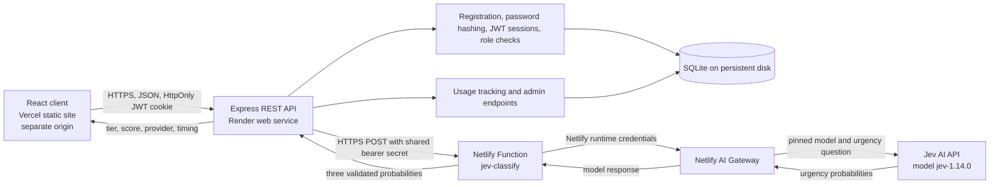
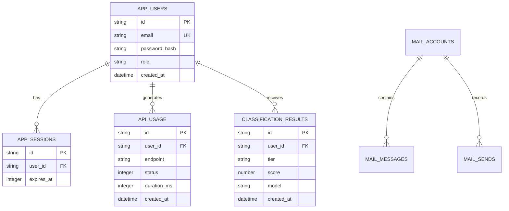

# Architecture

The browser and API are deployed independently. Express handles account authentication, role checks, priority policy, classification history, usage recording, and optional mailbox integration. SQLite persists users, session revocation records, and usage events. Netlify hosts the classification function, which submits the fixed urgency question using its managed gateway credentials. The API forwards the five classification fields and authenticates separately from the user's session.

## Data model

Classification history intentionally stores the result metadata, not the email text entered by the user.

For local development, Vite runs at `http://localhost:5173` and Express runs at `http://localhost:8000`; the browser calls the API directly with credentialed CORS. Production requires HTTPS on both origins, exact `CLIENT_ORIGIN` and `PUBLIC_URL` values, a persistent disk, and one API instance while using SQLite.
