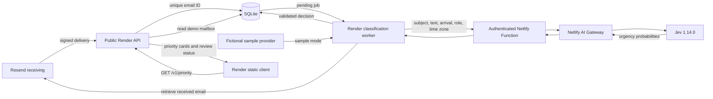

# Public demo architecture

In sample mode the mailbox namespace includes a digest of the pinned model, rubric, recipient context and fictional inputs. In receiving mode the worker uses a separate namespace for the real address. A verified webhook wakes the worker. It fetches the original by Resend email ID and checks the delivery envelope again. The worker keeps links, email addresses, quoted history, and signatures out of model inputs and public previews using the text cleanup rules. Routine real mail retains its decision and deduplication metadata with an empty subject and preview.

The priority policy admits an email when Emergency plus Urgent probability is at least 0.80. An admitted email is Emergency at an Emergency probability of at least 0.75. Other admitted emails are Urgent. The public read path uses the model's stored tier and excludes records without probabilities.

The browser reads one public inbox. Existing private accounts and study records stay in their original namespaces. The API keeps Resend and Jev credentials on the server.
