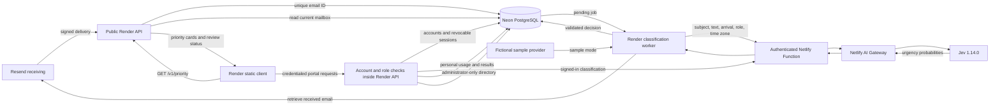

# Public demo architecture

In sample mode the mailbox namespace includes a digest of the pinned model, rubric, recipient context and fictional inputs. In receiving mode the worker uses a separate namespace for the real address. A verified webhook wakes the worker. It fetches the original by Resend email ID and checks the delivery envelope again. The worker cleans links, email addresses, quoted history, and signatures from model inputs and public mail text. Routine real mail retains its cleaned subject and arrival time alongside the decision and deduplication metadata. Its body and preview are discarded. An expanded group reads the stored subjects and arrival times from PostgreSQL.

The priority policy admits an email when Emergency plus Urgent probability is at least 0.80. An admitted email is Emergency at an Emergency probability of at least 0.75. Other admitted emails are Urgent. The public read path uses the model's stored tier and excludes records without probabilities.

The database enforces uniqueness on the mailbox and provider ID. Workers claim rows atomically with `FOR UPDATE SKIP LOCKED`. A worker that crashes leaves a one-minute lease. After it expires, another worker can claim the job. Only the current claim can commit a result. A committed decision survives a redeploy. An interrupted external inference can be repeated if its result never reached PostgreSQL.

The browser reads one public inbox. The Render API keeps the Neon connection string and both providers' credentials on the server.

The account portal uses the same Render API process and Neon database. Its tables hold scrypt password hashes, user roles, sessions and per-user classification receipts. Public inbox reads and Resend deliveries are separate from personal API usage. The static client, Render API, Neon and Netlify inference function are independently hosted.
